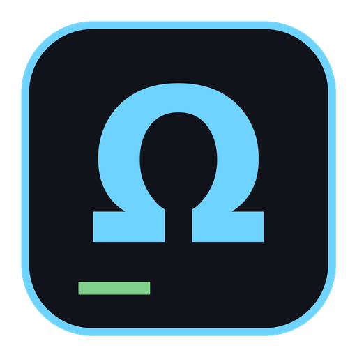

<p align="center">
  
</p>

<h1 align="center">TerminalOmega</h1>

<p align="center">
  Your server, its resource usage, and your local work, together in one window.
</p>

TerminalOmega is a terminal app written in Rust for people who manage servers
while working locally. Connect to a saved SSH session and btop opens for that
server automatically, next to a normal local terminal where you can edit code or
run tools like Claude Code.

```text
┌───────────────────────────┬───────────────────────────┐
│ server-1 │ server-2 │ +   │ btop: server-1    Refresh │
├───────────────────────────┼───────────────────────────┤
│                           │                           │
│ root@server-1:~#          │   live btop for the       │
│                           │   selected server tab     │
│                           ├───────────────────────────┤
│                           │ shell 1 │ claude │ +      │
│                           ├───────────────────────────┤
│                           │                           │
│                           │ you@laptop:~/project$     │
│                           │                           │
└───────────────────────────┴───────────────────────────┘
```

## Features

- **Saved SSH sessions:** connect in one click. Hosts can also be aliases from
  `~/.ssh/config`, which is the place for options such as `ProxyJump`.
- **btop follows your tab:** the monitor always shows the server selected on the
  left, and shows this machine for a local tab.
- **One login:** btop reuses the main terminal's SSH connection through OpenSSH
  multiplexing, so it never asks for a password.
- **Saved passwords:** for servers that need a password login, the password can
  be saved encrypted in the system keychain and is typed in for you.
- **Missing btop handled:** if btop isn't on the server, the pane tells you.
  Install it in the main terminal and press **Refresh**.
- **Tabs** in the main and local panes, with draggable dividers and fullscreen.
- **Terminal support:** 256-color and true color, mouse reporting, scrollback,
  text selection that scrolls when you drag past the edge, clickable links and
  bracketed paste.
- **Customizable:** color themes (Omega, Solarized Dark, Nord, Gruvbox Dark,
  Dracula), font and background colors, font file and size, background image.

## Install

Requires the OpenSSH client (`ssh`). btop is optional and only needed on the
machines you want to monitor.

Download the package for your system from
[Releases](https://github.com/dansecan25/TerminalOmega/releases), then run:

```sh
tar xzf terminal-omega-*.tar.gz
./terminal-omega-*/install.sh
```

The installer works per user and doesn't need sudo.

| System | Where to find the app |
| --- | --- |
| Ubuntu or another Linux desktop | Show Apps, as **TerminalOmega** |
| macOS | `~/Applications` or Spotlight |

> [!NOTE]
> Linux packages only run on systems with the same or a newer glibc than the
> machine that built them. If the installer says a build can't run on your
> system, [build your own package](#build-from-source).

> [!WARNING]
> macOS support is experimental and hasn't been tested on a real Mac yet. The
> app isn't notarized by Apple, so a managed Mac may block it.

### Update

The app checks [Releases](https://github.com/dansecan25/TerminalOmega/releases)
when it starts and every 12 hours, and downloads the package for your system in
the background. When it's ready, the top bar offers **Install**, then **Restart
now**. Restarting closes all terminals, so you can also choose **Later** and keep
working: the new version starts next time.

Turn this off, or check right away, under **Settings**. Only a copy installed
with `install.sh` updates itself, not one run from a source checkout.

To update by hand, download a newer package and run its `install.sh` the same
way, then restart the app. Your sessions and settings are kept either way.

### Uninstall

```sh
./terminal-omega-*/install.sh --uninstall
```

Your sessions and settings are kept. To remove them too, delete the config folder
listed under [Sessions and settings](#sessions-and-settings).

## Build from source

You need [Rust](https://rustup.rs) and a C compiler. On macOS, install the Xcode
command line tools with `xcode-select --install`.

```sh
git clone https://github.com/dansecan25/TerminalOmega.git
cd TerminalOmega
cargo run --release
```

To create an installable package for the system you're on:

```sh
./release.sh          # package the version in Cargo.toml
./release.sh 0.2.0    # set a new version in Cargo.toml, then package it
```

The package is written to `dist/terminal-omega-<version>-<os>-<arch>.tar.gz`.
`release.sh` doesn't commit, tag or upload anything. macOS packages have to be
built on a Mac.

## Sessions and settings

Open **SSH Sessions** or **Settings** from the top bar. Everything is stored in:

| System | Location |
| --- | --- |
| Linux | `~/.config/terminal-omega/config.json` |
| macOS | `~/Library/Application Support/terminal-omega/config.json` |

SSH keys give you true one-click connections. For servers that need a password,
enter it in the session's **Password** field:

- It's encrypted in the system keychain (Keychain on macOS, GNOME Keyring or
  KWallet on Linux), never in `config.json`.
- It's typed in once, at ssh's password prompt, before login finishes. If the
  server rejects it, you type it yourself and the app tells you.
- It can't be viewed or copied once saved. If it changes, edit the session,
  click **Clear password**, enter the new one and save.

After an update, macOS may ask whether TerminalOmega can use the saved
password. Choose **Always Allow**.

## Keyboard shortcuts

| Linux | macOS | Action |
| --- | --- | --- |
| Ctrl+Shift+C | Cmd+C | Copy selection |
| Ctrl+Shift+V | Cmd+V | Paste |
| Ctrl+Shift+T | Cmd+T | New tab in the focused pane |
| Ctrl+Shift+W | Cmd+W | Close tab in the focused pane |
| Ctrl+Tab | Ctrl+Tab | Next tab |
| Ctrl+Shift+Tab | Ctrl+Shift+Tab | Previous tab |
| Ctrl+Shift+1, 2, 3 | Cmd+1, 2, 3 | Focus the main, btop or local pane |
| Ctrl+Shift+R | Cmd+R | Run btop again |
| F11 | F11 | Fullscreen |
| Ctrl+click a link | Cmd+click a link | Open it in the default browser |

Hold Shift while dragging to select text in programs that capture the mouse.
To select more than fits on screen, drag past the top or bottom edge and the
terminal scrolls. Only `http` and `https` links are opened.

## Built with

[egui](https://github.com/emilk/egui) for the interface,
[alacritty_terminal](https://github.com/alacritty/alacritty) for terminal
emulation, and your system's OpenSSH client for connections, so your existing
keys, agent and `known_hosts` keep working. Symbols are drawn with the bundled
[Noto Sans Symbols](https://fonts.google.com/noto) fonts, under the
[SIL Open Font License](assets/fonts/OFL.txt).
